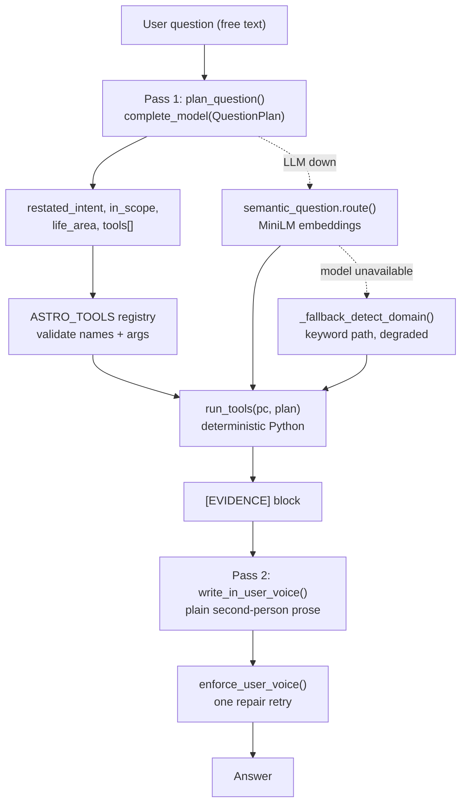

# LLM tool-calling chat, answered in plain user voice

## Review of commit 82c40d0 ("Enhance astrological chat reasoning & gemstone analysis")

What is good: the gemstone path genuinely works. `audit_chart_gemstones()` computes a real Parashari safety verdict per planet from house lordship, and `answer_chat_with_confluence()` feeds the whole audit to the model as `[PILLAR 6]` with a hard instruction never to recommend an `AVOID` stone. That is why gemstone answers come out right.

Three things in it are not fine, plus the hardcoding you already spotted.

### 1. Authorization regression (must fix)
The commit changed `report_get(rid, user["id"])` to `report_get(rid)` in five endpoints, and replaced the ownership check with `_report_unlocked()` or `not rep.get("paid")`. But `_report_unlocked()` returns `True` for **any** report whose `paid` flag is set, regardless of owner:

```375:377:api.py
def _report_unlocked(rep: dict, uid: str) -> bool:
    if bool(rep.get("paid")) or has_full_access_id(uid):
        return True
```

So any logged-in user who knows a report id can now open, PDF-download, and chat about **another user's paid reading**. Affected: `serve_file` (`api.py:419`), `one_report` (`:505`), `report_pdf` (`:559`), `report_chat_history` (`:650`), `report_chat` (`:665`).

### 2. Hardcoded 2026 ephemeris
`audit_gate0_hardware()` and `analyze_chandra_nadi()` hardcode this year's transit signs as literals -- `pisces_dist` assumes Saturn is in Pisces, `aquarius_dist` assumes Rahu is in Aquarius, and `jup_sign == "Pisces"` assumes transit Saturn conjoins there. Every Sade Sati and nodal verdict silently goes wrong once Saturn leaves Pisces.

### 3. A cross-chart bug in the gemstone verdict
The general (non-specific) gemstone branch appends this to the verdict for **every** ascendant:

> `Caution: Avoid Emerald (Mercury - Kendradhipati/Maraka for Pisces Lagna)`

An Aries-ascendant client is told about Pisces mechanics. The same commit also embeds private case labels -- `(Hannu case pattern)`, `(Shanu case pattern)`, `(Ishu pattern)` -- in reason strings that are fed to the model and can leak into a client answer.

### 4. The hardcoding you want removed
`detect_domain()` now front-runs a 15-line gemstone regex including typo spellings (`emerland`, `emrald`, `lahsuniya`), `INTENT_KEYPHRASES` gained literal question strings (`"why emerland"`, `"is panna good"`, `"emerald is not suitable"`), and `analyze_question_confluence()` picks the target planet with a 9-branch `if/elif` keyword chain. Separately, `is_strictly_out_of_domain()` was reordered so its generic token list (`"when"`, `"year"`, `"problem"`, `"delay"`, `"direction"`) runs *before* the trivia check, which defeats scope detection almost entirely.

---

## Target architecture

Pass 1 the model understands the question and picks tools. We run the Python. Pass 2 the model writes the answer in your voice. No keyword tables on the live path.



Why two-pass JSON rather than `tools=`: `core/llm_client.py:211-245` already has a hardened three-pass structured path (`response_format json_schema` -> vLLM `guided_json` -> repair retry). It works on any vLLM without `--enable-auto-tool-choice`, so nothing about the deployment has to change.

---

## Work

### A. New `engines/astro/astro_tools.py` -- the tool registry

One `AstroTool` dataclass (`name`, `description`, `arg_spec`, `fn`) and an `ASTRO_TOOLS` dict. The `description` strings are the only thing the model reads to choose, so they are written in question terms ("use when the user asks whether a specific stone is safe to wear"). Every `fn` takes `pc` plus validated kwargs and returns a JSON-safe dict. All of them wrap existing code -- **no new astrology math**:

- `life_area_confluence(pc, area)` -> `analyze_question_confluence(pc, q, domain_override=area)`
- `gemstone_audit(pc)` -> `audit_chart_gemstones` (`confluence_question_engine.py:358`)
- `gemstone_for_planet(pc, planet)` -> one planet's slice of that audit; this is what replaces the `if/elif` chain
- `event_promise(pc, event)` -> dispatch into `future_event_timing.py:436-848` (`assess_marriage_promise`, `assess_child_promise`, `assess_career_promise`, `assess_property_promise`, `assess_education_promise`, `assess_travel_promise`, `assess_business_promise`, `assess_recovery_promise`, `assess_wealth_promise`, `assess_status_promise`)
- `area_promise(pc, area)` -> `personalized_confluence.resolve_promise` (`:408`) -- canonical natal promise, the same one the paid report uses, so chat cannot contradict the report
- `timing_windows(pc, question)` -> `question_answer.answer` (`:521`) -- dated windows plus verdict
- `dasha_windows(pc, months)` -> `classical_timing.horizon_buckets` (`:136`)
- `dasha_at_date(pc, date)` -> `report_confluence.dasha_confluence` (`:1081`) -- Vimshottari + Yogini + Chara + BNN at one date
- `eventful_years(pc)` -> `gk_transit_dasha.upcoming_eventful_years` (`:348`)
- `live_transits(pc)` -> `transit_planet_analysis.analyze_transit_planet` (`:131`) -- current transit cards with dasha overlay
- `mind_and_transits(pc)` -> `analyze_chandra_nadi` (`:2289`)
- `chart_strength(pc)` -> `compute_chart_ashtakavarga` (`:453`)
- `structural_audit(pc)` -> `audit_gate0_hardware` (`:2202`)
- `nodes_analysis(pc, topic)` -> `rahu_ketu_analysis.analyze_progeny` / `analyze_medical` / `analyze_yogas`
- `planet_condition(pc, planet)` -> `period_planet_status.planet_strength` + `planet_role` (`:77`, `:82`)
- `longevity_context(pc)` -> `confluence_longevity_lane.build_longevity_context` (`:131`)
- `remedies(pc, area, lang)` -> `remedy_block.build` (`:156`) -- already language-aware

Three argument details the registry has to supply rather than let the model guess:

- `assess_marriage_promise(pc, *, female: bool)` needs gender -> fill from `chart_client.female_from_pc(pc)` (`:10`).
- `upcoming_eventful_years(pc, birth_year, n)` needs `birth_year` -> derive from `pc["meta"]["dob"]`.
- `longevity_analysis.py` has no `pc`-first entry points (its functions take an OCR `book` dict), which is why longevity routes through `confluence_longevity_lane` instead.

`run_tools(pc, plan)` executes at most 4, whitelist-checked, each in its own `try/except`, and returns `{tool_name: result}`. Dataclass returns (`AreaReport`, `LongevityContext`, `RahuKetuReading`) get `asdict()`-ed before serialization.

### B. New `engines/astro/llm/question_planner.py` -- both passes

`plan_question(question, history, area_hint)` calls `complete_model(QuestionPlan, ...)`. New schemas in [engines/astro/llm/schemas.py](engines/astro/llm/schemas.py):

```python
class ToolArgs(BaseModel):
    model_config = ConfigDict(extra="forbid")
    area: str = ""
    planet: str = ""
    event: str = ""
    topic: str = ""
    months: int = 0

class ToolRequest(BaseModel):
    model_config = ConfigDict(extra="forbid")
    tool: str
    args: ToolArgs = Field(default_factory=ToolArgs)

class QuestionPlan(BaseModel):
    model_config = ConfigDict(extra="forbid")
    restated_intent: str = Field(..., max_length=300)
    in_scope: bool = True
    life_area: str = "general_destiny"
    tools: list[ToolRequest] = Field(default_factory=list, max_length=4)
```

`ToolArgs` is a flat typed model rather than `dict[str, str]` because OpenAI-strict `json_schema` rejects open `additionalProperties`.

The planner's system prompt is **generated from the registry and from `DOMAINS_CONFIG`** so there is one source of truth. The 13 domain keys stay -- that is a taxonomy of astrological houses, not question-keyword mapping -- but the model now picks from their `title` semantically instead of us regex-matching the question.

`in_scope=False` from the planner replaces `is_strictly_out_of_domain()` on the live path.

### C. Pass 2: plain second-person voice

`write_in_user_voice(question, plan, tool_results, history, lang)` -- a plain-text completion (same direct-client style already in the module) whose style contract is explicit:

- Open with one sentence that answers exactly what was asked, in the asker's own framing.
- Second person only. Banned: "the native", "the seeker", "the querent", "the client", "this chart indicates".
- A Sanskrit or technical term is allowed **only with a plain-English gloss in the same sentence** -- "Saturn's seven-and-a-half-year pressure cycle (Sade Sati)", not a bare "Kendradhipati Dosha" or "SAV bindus".
- No mechanical pillar headers; at most two short bolded lead-ins (the frontend renders markdown via `miniMd()` at [site/index.html](site/index.html):2580).
- 150-350 words, 3-5 short paragraphs.
- Only facts present in `[EVIDENCE]`; never a stone, date, or planet that is not there.

New `enforce_user_voice(text)` in [engines/astro/llm/validate.py](engines/astro/llm/validate.py): reject third-person referents and un-glossed jargon, allow one repair retry, then fall back to the deterministic prose. This also closes the current gap where the confluence chat path bypasses `validate_chat_answer` entirely.

`lang` is threaded through so Hinglish/Tenglish keeps working. Neither `answer_chat_with_confluence()` nor `humanize_chat()` takes a language today, so a reader who bought a Hinglish reading gets English replies when they ask a follow-up about it. No new request field is needed: `core/handlers.py:555` already persists the choice as `meta["language"]`, so `report_chat` can read it off the report and pass it down. Codes in use are `en`, `hi_en`/`hinglish`, `te_en`/`tenglish` ([engines/astro/llm/rules.py](engines/astro/llm/rules.py):590-824).

### D. Rewire [engines/astro/confluence_question_engine.py](engines/astro/confluence_question_engine.py)

- `answer_chat_with_confluence()` becomes a thin orchestrator: plan -> run tools -> write voice -> validate.
- `analyze_question_confluence()` gains `target_planet: str = ""`; the 9-branch keyword chain in the gemstone block is deleted and the value comes from the planner.
- Delete the gemstone regex block at `:821-836` and the literal question phrases added to `INTENT_KEYPHRASES["gemstones_remedies"]`.
- Rename `detect_domain` -> keep as `_fallback_detect_domain`, reached only when the planner returns `None` (LLM off or endpoint down), so nothing regresses when the model is unavailable. Before dropping to keywords, try `semantic_question.route()` ([engines/astro/semantic_question.py](engines/astro/semantic_question.py):400) -- it runs `paraphrase-multilingual-MiniLM-L12-v2` locally and already reports `method` and `degraded` on its `SemanticRoute`, so there is a real semantic tier between the planner and the keyword tables.
- Same planner is used by the initial `user_question` report, so `synthesize_with_qwen()` picks up the same voice rules -- otherwise the report and the chat about it would read in two different voices.

### E. Fix the bugs from that commit

1. Derive the gemstone caution line from the chart's own `AVOID` list instead of the hardcoded Pisces/Emerald string.
2. Read current transit signs from the live ephemeris in `audit_gate0_hardware()` and `analyze_chandra_nadi()` instead of the 2026 literals.
3. Strip `(Hannu case pattern)` / `(Shanu case pattern)` / `(Ishu pattern)` from reason strings.
4. Restore the trivia check ordering in `is_strictly_out_of_domain()` (fallback path only) and drop the over-generic tokens `when`, `year`, `years`, `month`, `problem`, `direction`.
5. `ChatAnswer.answer` is `max_length=4000` but `rules.py` asks for up to 800 words (~4800 chars) -- raise the ceiling to 6000 so long answers stop failing validation.
6. `deploy/docker-compose.yml:23` `LLM_TABS` default still lacks `chat` while `docker-compose.local.yml` now has it; add it so chat is not silently off in that deployment.

### F. Authorization fix in [api.py](api.py)

Add one helper and use it in all five endpoints:

```python
def _owns_report(rep: dict, uid: str) -> bool:
    """Ownership, not payment. _report_unlocked() is a payment gate only."""
    return str(rep.get("user_id")) == str(uid) or has_full_access_id(uid)
```

Apply at `serve_file` (`:419`), `one_report` (`:505`), `report_pdf` (`:559`), `report_chat_history` (`:650`), `report_chat` (`:665`), and drop the `not rep.get("paid")` clauses, which invert the intended check.

### G. Verification

Exercise the planner against a spread of questions with no keyword overlap with any domain list, confirming the right tool is chosen and the answer has no third-person referents or bare jargon:

- "will my son start talking clearly" -> `speech_neurology` + `event_promise`
- "should I hold on to my flat or sell" -> `property_assets` + `event_promise(property)`
- "can I wear panna" and "emerland suits me?" -> `gemstone_for_planet(Mercury)` (typos handled by the model, not a regex)
- "thinking of moving to Canada next year" -> `foreign_relocation` + `dasha_windows`
- "how do I reverse a linked list in python" -> `in_scope=False`
- LLM forced off: confirm the fallback keyword path still answers.